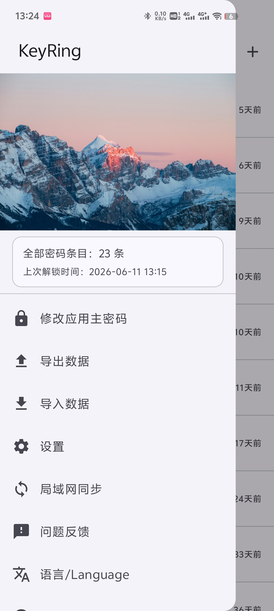

# KeyRing

> 一个本地优先、以隐私与实用为核心的 Android 密码管理器。  
> A local-first Android password manager focused on privacy and practical usability.

**更多APP照片在screenshots里**

 


## 快速导航 / Quick Navigation

- [中文版](#中文版)
- [English](#english)

---

## 中文版

### 项目定位

**KeyRing** 是一款运行在 Android 设备上的本地密码管理应用，用于集中保存常见账号信息（登录账户、用户名、密码、网站地址等），并提供快速检索、编辑、图片辅助区分、导入导出备份等能力。  
项目目标是：**离线可用、上手简单、兼顾安全与体验**。

### 核心功能

- **应用主密码保护**
  - 首次启动需设置主密码（确认输入）
  - 后续进入需解锁
  - 支持修改应用主密码
- **生物识别解锁**
  - 可在设置中启用/关闭
  - 启用时先校验主密码
  - 使用 Android Keystore + BiometricPrompt 做安全解密
- **密码条目管理**
  - 新增、查看、编辑、删除
  - 字段包含：标题、登录账户、用户名、密码、确认密码、网站地址、描述、标签
- **密码生成器**
  - 在设置页配置长度与字符集（大小写/数字/符号）
  - 新增/编辑页可一键生成并填充
- **网站图标（Favicon）**
  - 在新增/编辑页可从网站获取图标作为条目头像
  - 设置中有“允许使用网络”开关（默认关闭）
- **图片与头像**
  - 支持相册选图作为头像
  - 支持添加多张附件图片
- **搜索与排序**
  - 支持关键字搜索
  - 支持按名称/时间升降序
- **备份能力**
  - 使用独立密码加密导出 `.krbackup`
  - 支持导入加密备份与旧版 ZIP / JSON
- **局域网同步**
  - 同一 Wi-Fi 下设备间点对点加密同步
  - 支持双向数据合并（拉取并推送）
  - 基于配对码与信任密钥的安全传输
  - 可配置重复条目合并策略
- **关于页信息完善**
  - 开源依赖、图片素材引用、免责声明、版权声明
- **多语言**
  - 跟随系统 / 简体中文 / English

### 安全与隐私说明

- 数据默认存储在本机（本地优先）
- 应用主密码使用随机 16 字节盐和 PBKDF2-HMAC-SHA256（600,000 轮）校验，不存明文；旧 SHA-256 校验记录在正确解锁后自动升级
- 整个 Room 数据库使用 SQLCipher 加密，随机数据库密钥由 Android Keystore 保护；首次升级会迁移原有明文库，迁移失败不会主动清空原库
- 新备份为 `.krbackup` 加密归档（PBKDF2 + 分块 AES-256-GCM），包含条目与图片；备份密码独立于应用主密码，至少 8 位。恢复备份必须提供导出时的密码
- 旧版 ZIP / JSON 备份仍支持导入；旧备份文件不会自动变成密文。新备份无法由旧版应用或普通 ZIP 工具打开
- 直接复制数据库到其他设备无法恢复设备绑定的密钥，请使用应用的加密导出/导入迁移数据
- 生物识别能力基于系统安全组件（Keystore + Biometric）
- 仅当用户主动开启网络并使用网站图标功能时，应用才会访问对应网站获取图标

### 技术栈

- Kotlin
- Jetpack Compose + Material 3
- Navigation Compose
- Room + KSP
- AndroidX Security Crypto
- Biometric
- Coil
- Ktor (网络通信框架，用于局域网同步)
- Kotlinx Serialization (数据序列化，用于同步传输)

### 构建与运行

#### 环境建议

- Android Studio（较新稳定版）
- JDK 17 或 Android Studio 自带的 JBR（Java / Kotlin 字节码目标为 11）
- Android SDK（minSdk 29）

#### 常用命令

```bash
# Debug 构建
./gradlew :app:assembleDebug

# Release 构建
./gradlew :app:assembleRelease
```

> Windows 可用 `gradlew.bat`。

### 包体积优化（已完成）

- 已启用 `release` 的 R8 代码压缩与资源裁剪
- 已限制打包语言资源为中英两套
- Release 包体积已从约 49.6MB 优化到约 6.2MB（随版本略有波动）

### 路线图（建议）

- 问题反馈支持一键发邮件/复制邮箱
- 语言包补全（全量英文文案）
- 数据加密备份策略增强
- UI 细节与平板适配

---

## English

### Purpose

**KeyRing** is a local-first Android password manager designed to store and manage account credentials securely and efficiently on-device.  
The project focuses on **offline usability, privacy, and clean user experience**.

### Key Features

- **Master password protection**
  - Set on first launch
  - Required on app unlock
  - Change master password from drawer menu
- **Biometric unlock**
  - Optional in settings
  - Requires master-password verification before enrollment
  - Backed by Android Keystore + BiometricPrompt
- **Password entry management**
  - Create, view, edit, delete entries
  - Fields: title, login account, username, password, confirm password, website URL, description, tags
- **Password generator**
  - Configurable length and charset types
  - One-tap generation in add/edit screens
- **Website favicon support**
  - Fetch website icon as entry avatar
  - Controlled by a dedicated network toggle (off by default)
- **Images and avatars**
  - Custom avatar from gallery
  - Multiple attachment images
- **Search and sort**
  - Keyword search
  - Sort by name/time in ascending/descending order
- **Backup**
  - Export data
  - Import data
- **LAN sync**
  - Peer-to-peer encrypted sync between devices on the same Wi-Fi
  - Bidirectional data merging (pull then push)
  - Secure transmission with pairing code and trust key
  - Configurable duplicate entry merge policy
- **About page**
  - Open-source libraries, image attributions, disclaimers, copyright notes
- **Language options**
  - System default / Simplified Chinese / English

### Privacy & Security

- Local-first data storage
- Master password verified with PBKDF2-HMAC-SHA256 (600,000 iterations, random 16-byte salt); successful legacy SHA-256 unlocks upgrade the verifier
- Full Room database encryption with SQLCipher; a random database key is protected by Android Keystore. Existing plaintext databases are migrated with a recoverable staged replacement
- New `.krbackup` exports encrypt all entries and images with PBKDF2 and chunked AES-256-GCM. A separate backup password of at least 8 characters is required; changing the app password does not change older backups
- Legacy ZIP / JSON imports remain supported; existing backup files remain unchanged. New backups require this app version and cannot be opened by ordinary ZIP tools
- Use encrypted exports to move data between devices; copying a database does not transfer its device-bound key
- Biometric flow protected with Android platform security components
- Network is only used when explicitly enabled and when favicon fetch is requested

### Tech Stack

- Kotlin
- Jetpack Compose + Material 3
- Navigation Compose
- Room + KSP
- AndroidX Security Crypto
- Biometric
- Coil

### Build

```bash
# Debug
./gradlew :app:assembleDebug

# Release
./gradlew :app:assembleRelease
```

Use `gradlew.bat` on Windows.

### APK Size Optimization

- Release minification and resource shrinking are enabled
- Packaged locales are restricted to Chinese and English
- Release APK size has been reduced significantly (roughly from ~49.6MB to ~6.2MB)

---

## License

This project is licensed under the **GNU Affero General Public License v3.0 (AGPL-3.0)**.

See the [LICENSE](LICENSE) file for details.


### 安全改造验证

- `./gradlew :app:assembleDebug :app:assembleDebugAndroidTest :app:compileDebugUnitTestKotlin`
- JVM：`SecurityCryptoTest` 覆盖密码派生、旧校验兼容、备份认证与完整性；`ImportLimitsTest` 覆盖导入配额。
- Android：`SecurityMigrationTest` 使用隔离数据库与偏好设置，覆盖原库迁移、迁移中断恢复、主密码校验升级、含图片的加密备份往返及认证失败时不写入条目。连接设备后运行 `./gradlew :app:connectedDebugAndroidTest -Pandroid.testInstrumentationRunnerArguments.class=com.wudongsong.keyring.SecurityMigrationTest`。
- 手工检查：正确/错误密码解锁、修改主密码、生物识别解锁、备份密码确认、导入旧 ZIP / JSON、换设备恢复新备份。
- 导入上限：JSON 8 MiB、单个附件 32 MiB、解压总量 256 MiB、最多 4096 个压缩条目。
- SQLCipher 集成依据：[官方 Android 项目](https://github.com/sqlcipher/sqlcipher-android) 与 [数据库导出迁移 API](https://www.zetetic.net/sqlcipher/sqlcipher-api/#sqlcipher_export)。


### 待统一纳入 1.3 的可靠性改造（尚未发布）

- 编辑图片按草稿管理，保存成功后才清理原图；取消仅清理本次新增文件。重复保存会被拦截，失败保留表单。草稿只保留在当前进程内，重新进入对应编辑页可以继续；进程结束后不保留。
- 备份导入先预览新增、更新、跳过数量，可选择跳过重复（默认）、仅覆盖较新记录或保留两份；实际导入重新检查当前库并在 Room 事务中提交。取消预览会清理导入的临时图片。
- 同步信任密钥迁移至加密偏好设置，成功写入后删除原明文记录。配对使用分组随机码，5 分钟有效、成功后失效，最多 5 次确认尝试；需重新开启接收以生成新码。
- 同步协议升级为 v2：两端均需使用新构建，增加请求时效、防重放和响应绑定；同步压缩归档上限为 8 MiB（手动备份仍使用单独的备份配额）。
- 安全设置增加截图/录屏保护及复制内容自动清理，默认开启。剪贴板清理只匹配本应用本次复制的内容；后台访问被系统限制时，在回到应用后补做检查。进程被终止后应用定时器不能继续执行。
- 设备端验证清单：旧 APK 覆盖升级；编辑更换/移除图片后取消；保存失败重试；旋转与锁屏后草稿；重复导入与导入取消；双机配对/同步；截图开关与剪贴板切换应用。


### 生物识别与启动流畅度修复（本地待发布）

- Keystore 密钥生成/读取/删除、Cipher 初始化和加解密、保险库偏好设置读写均在 IO 调度器执行，仅系统生物识别弹窗留在主线程。
- 生物识别改为可取消的挂起操作：准备、系统验证和后续写入期间保持忙碌状态，阻止重复触发；页面销毁会取消尚未结束的弹窗。
- 首次主密码状态检查的加密偏好设置与主密钥初始化移至 IO；解锁图标使用异步图片加载。
- `AuthResponsivenessTest` 用阻塞的首次偏好设置读取和 UI 事件验证线程隔离。指纹传感器、系统弹窗及真实设备帧耗时仍需设备端实测；未降低密码派生强度或跳过解锁校验。
